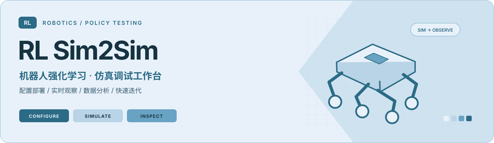
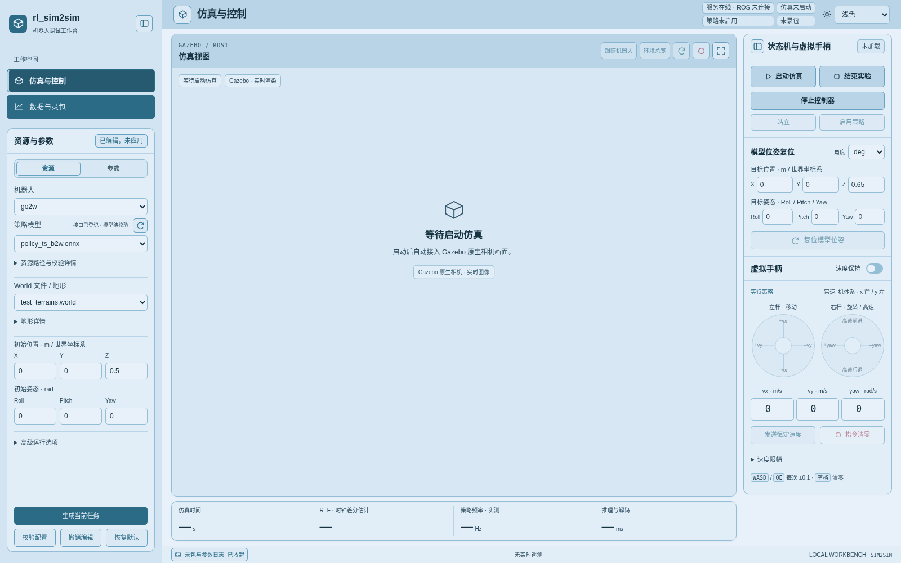
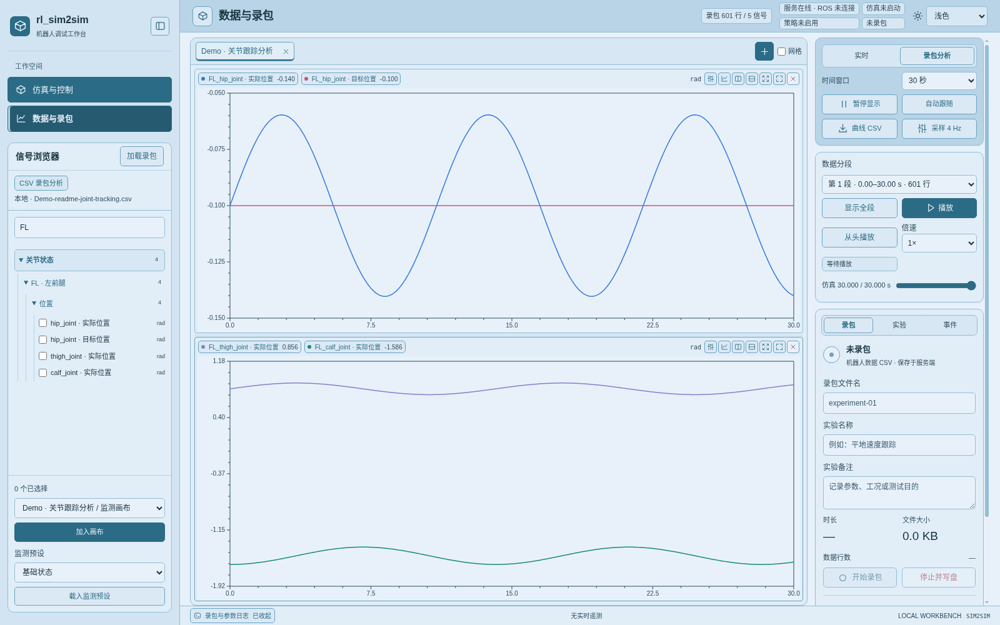
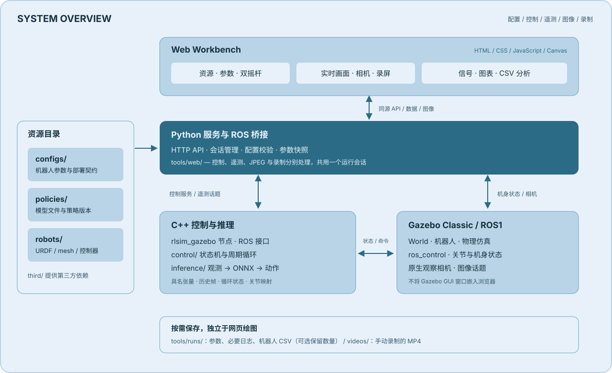
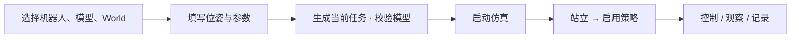

<div align="center">



**从训练后的策略，到可观察、可调参、可复现的仿真测试。**

`C++17` · `ONNX Runtime` · `ROS Noetic` · `Gazebo Classic 11` · `Web Workbench`

[快速开始](#quickstart) · [网页操作](#workbench) · [添加机器人](#new-robot) · [部署新策略](#new-policy) · [GitHub 发布](#publish)

</div>

---

RL Sim2Sim 面向**轮足、点足机器人**的强化学习策略部署与调试。项目将机器人资产、策略权重、部署配置、推理控制与网页工具分开管理，用配置描述观测、模型输入输出、循环状态和动作映射，减少更换机器人、测试策略时对控制代码的修改。

当前默认链路是 **Gazebo Classic / ROS1 + CPU float32 ONNX 推理**。项目接收训练完成的模型，不包含完整训练流水线；当前公开版以默认链路为范围，其他仿真器和实机部署不在本版支持范围。

## 项目可以做什么

| 能力 | 使用方式 |
| :--- | :--- |
| 配置驱动部署 | 具名输入输出、观测拼接、缩放、历史帧、隐藏状态反馈、动作与关节映射 |
| 网页仿真与控制 | 选择机器人、具体模型文件和 World，设置出生位姿，生成独立任务 |
| 快速测试策略 | 停止控制器后更换模型、策略 PD、参考关节位置与控制周期，再应用和启动 |
| 实时仿真画面 | Gazebo 原生相机；环绕、平移、缩放、跟随、环境总览和 MP4 录屏 |
| 交互式数据分析 | 信号树、拖拽曲线、Tab、上下/左右分割、共享时间轴、框选放大与一键完整显示 |
| CSV 录包与回放 | 服务端记录机器人数据，浏览器加载本地或历史 CSV，分段分析与播放 |
| 清晰的输出管理 | 集中保存参数快照与必要日志，任务输出可保留最近 5 / 10 / 20 次或全部 |

### 看看工作台

**仿真与控制 · 当前浅色主题预览**



*截图为未启动状态，展示当前 Arctic Frost 配色和页面布局；中央图像在仿真启动后接入。*

**数据与录包 · 离线分析示例**



*此图使用明确标注的 Demo CSV 展示图表功能，不是实时机器人遥测。*


<a id="architecture"></a>
## 系统架构



| 目录 | 内容 | 扩展时主要修改什么 |
| :--- | :--- | :--- |
| [`rlsim/`](rlsim/) | `inference/` 推理、观测、动作与状态；`control/` 状态机与控制循环；`interfaces/gazebo/` 仿真接口 | 新观测计算、新执行器或新适配器 |
| [`configs/`](configs/) | `wheel/`、`legged/` 机器人配置；共享仿真配置、空任务模板和 schema | 机器人参数与部署契约 |
| [`policies/`](policies/) | 按 `wheel/`、`legged/` 分类的模型，可保留策略与版本子目录 | 新权重与模型版本 |
| [`robots/`](robots/) | 分类管理的 URDF、xacro、mesh 和控制器配置 | 新机器人的物理资产 |
| [`third/`](third/) | ONNX Runtime、相机插件等默认构建依赖 | 构建依赖及可选扩展 |
| [`tools/`](tools/) | CLI、网页前后端、测试、文档、构建目录与任务输出 | 工具、界面和诊断 |

```text
RL_sim2sim/
├── rlsim/
│   ├── inference/
│   ├── control/
│   └── interfaces/gazebo/
│       ├── rlsim_gazebo/
│       ├── robot_controller/
│       ├── robot_msgs/
│       └── worlds/
├── configs/{wheel,legged}/
├── policies/{wheel,legged}/
├── robots/{wheel,legged}/
├── third/
├── tools/{web,docs,tests,build,runs}/
├── videos/                       # 手动录制的 MP4
└── build.sh
```

**一个机器人、一份主配置。** `robot` 声明资产与关节，`control` 声明默认控制，`policies` 描述部署接口。网页从 [`configs/task.yaml`](configs/task.yaml)复制空任务并补齐选择，修改仅作用于当前任务，不回写机器人默认配置。

浏览器使用原生 HTML / CSS / JavaScript / Canvas，服务端使用 Python HTTP 服务与 ROS 桥接进程；不需要 Node.js、npm 或前端开发服务器。控制、遥测、图像和录制分别管理，切页共用同一个运行会话。

源码只保留当前仿真链路：`third/` 包含 ONNX Runtime 与 Gazebo 相机插件，CLI 提供 `serve`、`assets`、`experiment`。旧架构、迁移基线与实机 SDK 不属于当前部署内容。`tools/tests/` 保留有效回归源码；缓存、测试截图和构建日志不纳入项目资源。公开发布副本放在开发项目之外。

<a id="requirements"></a>
## 环境与依赖

### 已验证的开发环境

| 项目 | 当前基线 | 用途 |
| :--- | :--- | :--- |
| 操作系统 | Ubuntu **20.04.6 LTS / x86_64** | 完整 ROS1/Gazebo 链路 |
| ROS / 仿真 | **ROS Noetic + Gazebo Classic 11**，本机 Gazebo 11.15.1 | 消息、控制器、物理仿真与相机 |
| C++ / 构建 | C++17、CMake ≥ 3.10、catkin_tools | 独立核心与 ROS 工作区 |
| 推理执行器 | **ONNX Runtime 1.20.1 / CPU** | 默认从 `third/onnxruntime-linux-x64-1.20.1` 查找 |
| 控制层依赖 | **LibTorch 2.0.1 CPU / C++11 ABI**、TBB、yaml-cpp | 当前控制层的数据结构、周期与配置 |
| Python | 系统 **Python 3.8**、PyYAML；ROS 子进程用 `/usr/bin/python3` | 网页、CLI 与 ROS 桥接 |
| 网页图像 | `gazebo_plugins`、`cv_bridge`、`python3-opencv` | 相机数据与 JPEG 编码 |
| 视频 | **FFmpeg，含 libx264 编码器** | H.264 / MP4 保存 |
| 浏览器 | 当前 Firefox / Chromium / Chrome | 主要适配 1280、1440、1920 像素宽度 |

**独立推理核心**只需要 C++17、CMake、yaml-cpp 与 ONNX Runtime。**完整仿真**还需要 ROS、Gazebo、LibTorch 和 TBB；ONNX 默认在 CPU 上运行，不要求 CUDA。Python 依赖入口为 [`tools/requirements.txt`](tools/requirements.txt)，当前仅声明 `PyYAML>=5.3,<7`。

ROS Noetic 和 Gazebo Classic 属于本项目沿用的旧版链路。其他 Ubuntu 版本、ARM 平台或新版 Gazebo 不能直接视为已支持，需要分别适配和验证。

<details>
<summary><b>安装依赖：Ubuntu 20.04 + ROS Noetic</b></summary>

先完成 [ROS Noetic 安装](https://wiki.ros.org/noetic/Installation/Ubuntu)，配置可用的软件源，再执行：

```bash
sudo apt update
sudo apt install -y \
  build-essential cmake git git-lfs unzip wget \
  python3-pip python3-yaml python3-catkin-tools \
  libyaml-cpp-dev libtbb-dev libboost-all-dev libgazebo11-dev \
  python3-opencv ffmpeg

sudo apt install -y \
  ros-noetic-desktop-full \
  ros-noetic-ros-control ros-noetic-ros-controllers \
  ros-noetic-gazebo-ros-pkgs ros-noetic-gazebo-ros-control \
  ros-noetic-cv-bridge ros-noetic-xacro
```

`python3-yaml` 已满足系统 Python 的工具依赖。若使用另外的 Python 环境，只为 CLI/网页补装：

```bash
python3 -m pip install -r tools/requirements.txt
```

ROS 桥接仍使用系统 Python；仅安装在 Conda 中的 `yaml`、`cv2` 或 `torch` 不会自动成为 ROS Python 的依赖。

建议退出 Conda 后编译，避免 CMake 选中 Conda 的 C++ 依赖。若链接时报 `GLIBCXX` 或 yaml-cpp 版本冲突，可为两次构建指定同一套 `-Dyaml-cpp_DIR=/path/to/yaml-cpp/lib/cmake/yaml-cpp`，并确认编译时头文件与链接库版本一致。

当前构建验证使用 LibTorch **2.0.1 CPU / C++11 ABI**，可从 [PyTorch 官方 CPU 存档](https://download.pytorch.org/libtorch/cpu/)安装相同版本：

```bash
mkdir -p "$HOME/.local/opt/rlsim-libtorch-2.0.1"
wget -O /tmp/rlsim-libtorch-2.0.1.zip \
  'https://download.pytorch.org/libtorch/cpu/libtorch-cxx11-abi-shared-with-deps-2.0.1%2Bcpu.zip'
unzip -n /tmp/rlsim-libtorch-2.0.1.zip \
  -d "$HOME/.local/opt/rlsim-libtorch-2.0.1"
export Torch_DIR="$HOME/.local/opt/rlsim-libtorch-2.0.1/libtorch/share/cmake/Torch"
```

`Torch_DIR` 应指向包含 `TorchConfig.cmake` 的目录。编译器 ABI 要与 ROS、yaml-cpp 和 LibTorch 一致，参见 [LibTorch 官方安装说明](https://docs.pytorch.org/cppdocs/installing.html)。

```bash
/usr/bin/python3 -c "import yaml, cv2; print('Python dependencies OK')"
ffmpeg -hide_banner -encoders | grep libx264
```

</details>

<a id="quickstart"></a>
## 编译与快速开始

以下命令均在**仓库根目录**执行。首次克隆后，如果仓库启用了 Git LFS，先执行 `git lfs pull`，确认模型和 mesh 是实际文件；发布前的大文件处理见[发布指南](tools/docs/github-publishing.md)。

### 1. 构建独立推理核心

```bash
./build.sh core -DCMAKE_BUILD_TYPE=Release

# C++ 单元检查
(cd tools/build/core && ctest --output-on-failure)

# 检查公开示例模型的真实输入输出接口
tools/build/core/rlsim_policy_run \
  'configs/wheel/go2w.yaml#/policies/go2w-ts-v001' "$PWD" --check

# 用合成状态连续推理 32 步，检查状态反馈与 reset
tools/build/core/rlsim_policy_run \
  'configs/wheel/go2w.yaml#/policies/go2w-ts-v001' "$PWD" 32
```

最后一条是**离线推理检查，不是动力学仿真**。使用自己的 ONNX Runtime 时，增加 `-DONNXRUNTIME_ROOT=/absolute/path/to/onnxruntime`；ROS1 构建也要传入相同参数。

### 2. 构建 ROS1 / Gazebo 接口

```bash
source /opt/ros/noetic/setup.bash

# 使用自己的安装路径时修改本行；按上文安装则沿用此目录
export Torch_DIR="$HOME/.local/opt/rlsim-libtorch-2.0.1/libtorch/share/cmake/Torch"
./build.sh ros1 -DTorch_DIR="$Torch_DIR"

source tools/build/ros1/devel/setup.bash
```

脚本会在 `tools/build/ros1` 创建隔离的 catkin 工作区，链接当前 Gazebo 包和相机依赖；不用恢复旧版 `src/` 布局。编译包含控制器、消息、配置驱动节点和网页观察相机插件。

### 3. 启动网页

```bash
bash tools/start_web.sh
```

打开 **<http://127.0.0.1:8765/>**。更换端口：`bash tools/start_web.sh --port 8766`。服务默认只监听本机回环地址；远程操作可使用 SSH 转发：

```bash
ssh -N -L 8765:127.0.0.1:8765 user@simulation-host
```

服务端仍需要可用的 **DISPLAY / OpenGL 图形上下文**。关闭原生 Gazebo 窗口只关闭 GUI，不等于无图形依赖。

### 4. 生成第一个任务

| 资源 | 首次验证示例 |
| :--- | :--- |
| 机器人 | `go2w`（示例；仍需核对物理资产与训练契约） |
| 策略文件 | `policies/wheel/go2w/legged_gym/policy_ts_b2w.onnx` |
| World | `flat`（共享仿真配置中的平地） |
| 初始位置 | 按模型尺寸填写安全出生位置，不直接复用其他机器人高度 |
| 初始姿态 | Roll / Pitch / Yaw 均为 `0` |
| 原生 Gazebo 窗口 | 默认关闭，在网页观察场景 |



生成成功后点击右侧 **启动仿真 → 等待连接就绪 → 站立 → 启用策略**。完成站立过渡再启用策略，用小速度检查方向、姿态和关节数据。完成后点击 **结束实验**，等待 CSV 或视频写盘结束。

<a id="workbench"></a>
## 网页使用

### 仿真与控制

左侧切换**资源 / 参数**，中间观察仿真，右侧操作状态机、模型复位和双摇杆。侧栏与控制栏可收起；主题可选浅色、深色、跟随系统，视口右上角可进入专注仿真。

| 操作 | 说明 |
| :--- | :--- |
| 资源选择 | 策略列表只显示所选机器人目录中的模型；选择具体 `.onnx`，后台关联部署接口 |
| 参数调整 | 腿部与轮子分别批量设置策略 Kp/Kd，可修改轮速 `vel_scale`、默认关节位置和控制周期 |
| 相机 | 左键环绕；右键或 Shift 拖动平移；滚轮缩放；支持跟随与环境总览 |
| 模型位姿复位 | 设置世界坐标 X/Y/Z 和 Roll/Pitch/Yaw，再复位模型；保持仿真、控制与策略状态 |
| 录屏 | 视口右上角开始/结束 MP4 录制，完成后自动保存到服务端 `videos/` |

**双摇杆与速度输入**

- 左杆：前进/后退、左右侧移；右杆：左右旋转，前后推动使用独立限幅的高速前后运动。
- 速度框可直接填写 `vx`、`vy`、`wz`，点击 **发送恒定速度** 持续发送，点击 **指令清零** 停止。
- **速度保持**保留松杆时的指令；常速、高速和旋转限幅分别设置。
- 键盘在手柄区域获得焦点后生效：`W/S` 调 vx、`A/D` 调 vy、`Q/E` 调 wz，每次按下增减 `0.1`；空格清零，长按不重复累加，编辑输入框时不触发。
- 速度保持/恒速可跨实时数据页继续；窗口失焦、断线或退出策略后归零，重连不自动恢复非零输入。后端指令超时保护独立生效。

### 不重启 Gazebo，迭代策略与参数

1. 点击 **停止控制器**，等待服务端确认停用。
2. 选择同一机器人的另一个兼容模型，或修改策略 PD、参考关节位置、轮速缩放和控制周期。
3. 点击 **应用到控制器**，等待实际模型与参数校验成功。
4. **启动控制器 → 站立 → 启用策略**，开始下一轮验证。

Gazebo 进程、相机和仿真时钟保持运行；停用控制器期间保留被动阻尼。机器人、World 与物理引擎参数仍需生成新任务。详见[控制器重载](tools/docs/public/configuration.md#控制器重载)。

### 数据与录包

| 需求 | 操作 |
| :--- | :--- |
| 查找信号 | 按类别搜索；关节按腿分组，再分位置、速度、力矩；策略动作命名为 `action0...` |
| 添加曲线 | 点 **+** 添加 Tab，拖单条/多条勾选信号到图中，或点击加入画布；成功后清空勾选 |
| 组织视图 | Tab 占满中间区域；每图可上下/左右拆分，连续同方向拆分与删除后自动均分 |
| 局部分析 | 滚轮缩放时间轴、拖动平移、Shift 拖框放大 X/Y 范围；悬停显示精确值 |
| 恢复完整视图 | 每图右上角 **显示全部数据** 适配完整时间范围和本图数值轴，不跨数据分段 |
| 恢复实时滚动 | 缩放后按钮同步为 **继续显示**，点击一次恢复；**自动跟随**也可恢复 |
| 调整采样 | 右侧设置网页采样 1 / 2 / 4 / 10 Hz；显示与录包频率分别管理 |
| 录制数据 | 填写文件名、实验名/备注和数据源，开始录包；停止后等待服务端完成写盘 |
| 加载历史 CSV | 左侧 **加载录包**，选择已完成的服务端文件或本地文件，再拖信号到画布 |
| 播放 CSV | 分段、播放/暂停、定位、从头播放和 0.25×–4×；仅播放数据，不驱动机器人 |

新工作区默认不创建图表；Tab、分割、信号组合、网格、主题和分栏宽度会保存。不同单位默认分图，同一信号颜色跨画布和主题保持一致。数据缺失或过期有明确提示，不用零补齐，不跨断流或仿真重置连线。

**采集、绘图和录制相互独立。** 网页缓冲上限 1800 帧；暂停显示和缩放不停止遥测采集、后台录包。CSV 分析在浏览器内进行，当前限制为 64 MB、20,000 行、200 万个信号数值；较大文件需先拆分。

### 输出在哪里

```text
tools/runs/<task-id>/
├── resolved_config.json          # 本次选择与已应用参数快照
├── parameters.log                # 参数生成与修改记录
├── robot-data-*.csv              # 主动录制的机器人数据
├── recording.log                 # 录制、备注、标记等必要日志
└── ...                           # 录制/视频状态元数据（按需生成）

videos/simulation-*.mp4           # 主动录制的视频，独立于任务清理
```

在网页 **数据与录包 → 录包 → 任务日志保留** 中选择 **5、10、20 次或保存所有**，默认 5 次。设置在服务端保存，刷新或重启网页服务后保持，CLI 与网页共用。修改设置不会中断仿真或录包；下一次成功生成新任务时，`tools/runs` 按所选数量清理，更早目录连同 CSV、参数和日志一起删除；选择“保存所有”则不自动清理。正在运行、录制或收尾的任务受保护，并占用保留名额。长期数据请先下载/备份；`videos/` 不参与该轮换规则。

默认不长期保存逐帧图像、遥测 JSONL、完整进程日志或普通运行事件。CSV 只保存已接入的机器人数据，约 10 Hz；**曲线 CSV 导出**只导出网页缓冲中选定信号，不能替代完整录包。

<a id="new-robot"></a>
## 添加一个新机器人

接入分为**资产 → 物理控制 → 策略契约 → 校验**。现有观测源和动作模式能覆盖时，不需要添加机器人名称的 C++ 分支。

### 1. 放置机器人资产

```text
robots/wheel/my_robot_description/      # 有轮关节
# 或 robots/legged/my_robot_description/ # 纯点足
├── package.xml                        # ROS 资源包信息与来源
├── CMakeLists.txt                     # 资源安装规则
├── urdf/                              # .urdf、.xacro 描述文件
│   ├── robot.urdf                     # 几何、惯量、关节、碰撞与 transmission
│   └── gazebo.xacro                   # 通用插件与本机接触参数
├── config/
│   └── controllers.yaml              # 控制器与关节的紧凑映射
└── meshes/                            # 实际使用的网格与纹理
```

核对关节、质量、惯量、碰撞体、限位与 mesh 路径。`gazebo.xacro` 引用后端的通用仿真宏，填写命名空间与实际根连杆；受控关节需要 effort transmission。保留 `_description` 包名供 ROS 资源定位，包内不再维护独立 launch、RViz 或 ROS2 配置。参考 [A1 xacro](robots/legged/a1_description/urdf/gazebo.xacro)和 [Go2W xacro](robots/wheel/go2w_description/urdf/gazebo.xacro)。

### 2. 创建唯一的机器人配置

按类型参考 [`configs/legged/a1.yaml`](configs/legged/a1.yaml)或 [`configs/wheel/go2w.yaml`](configs/wheel/go2w.yaml)，创建 `configs/legged/my_robot.yaml` 或 `configs/wheel/my_robot.yaml`。先保留 `policies: {}`，逐项填写：

| 区域 | 必须核对 |
| :--- | :--- |
| 顶层 | `schema_version: 1`、`kind: robot_profile`、唯一 `id` |
| `robot` | `robot_name`、`package`、`package_path`、`urdf`、`xacro`、`controllers`、`variant`、`excluded_plugins` |
| ROS 标识 | `model_name: my_robot_gazebo` 对应 `namespace: /my_robot_gazebo/` |
| `robot.joints` | 真实受控关节全集与顺序；当前适配器支持 1–32 个关节 |
| `robot.groups` | `legs`、`wheels` 不重叠，合并等于受控关节全集；点足为 `wheels: []` |
| `control.startup` | 与机器人顺序一致的初始位置、Kp/Kd、力矩限幅 |
| `control.transition` | 站立/坐下过渡目标、增益、时间与被动阻尼 |
| `control.timing` | `control_dt`、`decimation`；不能直接照搬另一机器人的增益和姿态 |

**向量长度与顺序必须一致。** 可以按腿折行，但数组仍是一维；标量不能代替每关节向量。策略关节顺序可以不同，程序按名称生成排列，双方受控关节集合必须一致。

```yaml
# 片段：仅展示身份和路径，不是完整可运行配置
schema_version: 1
kind: robot_profile
id: my_robot
robot:
  robot_name: my_robot
  package: my_robot_description
  package_path: robots/legged/my_robot_description
  urdf: robots/legged/my_robot_description/urdf/robot.urdf
  xacro: robots/legged/my_robot_description/urdf/gazebo.xacro
  controllers: robots/legged/my_robot_description/config/controllers.yaml
  model_name: my_robot_gazebo
  namespace: /my_robot_gazebo/
  # joints / groups / variant / excluded_plugins 按完整模板填写
# control 按完整模板和本机参数填写
policies: {}
```

### 3. 对齐 ROS 控制器与单位

控制器 YAML 的每个 `joint` 必须对应实际关节，命名空间与 `model_name` 一致。当前插件导出 `robot_controller/RobotJointController`，兼容旧资产中的 `robot_joint_controller/RobotJointController`，两者由同一个 `robot_controller` 包提供。

| 数据 | 约定 |
| :--- | :--- |
| 关节位置 / 速度 | rad / rad·s⁻¹，归一化另行配置 |
| 位置 / 线速度 | m / m·s⁻¹；网页指令 vx 向前、vy 向左 |
| 旋转指令 | wz，rad·s⁻¹ |
| 机身四元数 | 推理核心使用 **wxyz** |
| 出生/复位位姿 | 世界坐标系；deg/rad 仅为显示切换，协议保存 rad |
| 周期 | `policy_dt = control_dt × decimation`；控制周期须为物理步长整数倍 |

### 4. 注册策略并验证

按下一节填写契约。尚不具备部署条件时保留 `unconfigured` 与具体原因。新增资源后刷新网页目录；新机器人未出现在列表时重启网页服务重新读取。新增/修改 C++、消息或插件时重新执行 `./build.sh ros1`。

先执行 `/usr/bin/python3 tools/rlsim.py assets --check --xacro /opt/ros/noetic/bin/xacro`，验证几何树、网格、纹理、控制器和 Gazebo 引用。资产布局与接入方法见 [robots/README](robots/README.md)。随后检查实际模型，再从网页生成任务，完成站立、小速度测试和 CSV 观察。资产和模型接口检查成功不等于机器人动力学已验证。

<a id="new-policy"></a>
## 添加一个新策略部署

### 1. 导出模型并保存训练侧契约

当前执行器是**单模型、CPU、float32 ONNX**。归档的 `.pt`、`.jit` 或多模型资产不会因为修改扩展名而变得可运行。

导出时保存：输入输出名称/形状、观测拼接顺序、归一化/裁剪、历史、隐藏状态、动作语义、参考姿态、PD 和策略周期。**维度相同不代表语义相同**，关节顺序、重力坐标系或动作缩放不同也会导致运动错误。

```text
policies/legged/my_robot/walk/v001/policy.onnx
# 或 policies/wheel/my_robot/walk/v001/policy.onnx
```

### 2. 在机器人 YAML 的 policies 中登记

`deployment.id` 与映射键一致；`model_directory` 对应允许扫描的目录，`model.file` 是默认权重。网页最终选择具体文件，后台用此契约解释输入输出。

```yaml
# 片段：加入 configs/legged/my_robot.yaml 的 policies 映射
policies:
  my_robot-walk-v001:
    schema_version: 1
    id: my_robot-walk-v001
    model: {backend: onnxruntime, file: policies/legged/my_robot/walk/v001/policy.onnx}
    joints: {$ref: 'configs/legged/my_robot.yaml#/robot/joints'}
    # observations / inputs / states / actions 须完整填写，见下表及完整示例
    deployment:
      id: my_robot-walk-v001
      robots: [my_robot]
      status: ready
      diagnostics: []
      model_directory: policies/legged/my_robot/walk/v001
```

完整可对照的接口配置：[Go2W 示例](configs/wheel/go2w.yaml)。本例已通过模型接口和合成输入检查，未宣称完成闭环动力学验证。`ready` 仅表示允许尝试校验，启动前仍检查实际模型。

| 字段 | 如何与训练对齐 |
| :--- | :--- |
| `observations.<组>.terms` | 逐项声明 `source`、`width`、`scale`、`rotate_inverse`、`zero_indices`；顺序就是拼接顺序 |
| `history` | `offsets`、`time_major/term_major`、`zeros/repeat_first` 与训练缓冲一致 |
| `inputs` | **模型输入名 → 观测组名**，例如 `{obs: proprio}` |
| `states` | 每组状态独立绑定 `input` / `output` / `shape`；前馈模型用 `[]` |
| `actions` | `output`、`count`、`reference`、Kp/Kd、力矩与动作裁剪 |
| `actions.channels` | 模型动作索引映射到策略关节索引，配置控制模式与缩放 |

```yaml
# 循环模型示意：名称和尺寸必须来自实际模型
inputs: {obs: proprio}
states:
  - {input: h, output: he, shape: [3, 1, 256]}
  - {input: c, output: ce, shape: [3, 1, 256]}

# actions.channels 中单个条目示意
# {joint: 0, action: 0, mode: position_offset, scale: 0.25}
# {joint: 3, action: 3, mode: velocity, scale: 8.0}
```

动作支持 `position_offset`、`position`、`velocity`、`torque`。动作数可以不同于关节数，但映射必须完整合法；轮速通常用速度通道，Kp 与控制语义也需匹配。观测源与扩展方法见[推理核心说明](tools/docs/public/architecture.md)。

同一接口目录可以放多个**接口兼容**的 ONNX，网页会列出具体文件；输入输出、历史或动作语义改变时，应新建契约和目录。

### 3. 先检查，再仿真

```bash
# 将 my_robot 替换为已填写完整的机器人 ID/路径
tools/build/core/rlsim_policy_run \
  'configs/legged/my_robot.yaml#/policies/my_robot-walk-v001' "$PWD" --check

tools/build/core/rlsim_policy_run \
  'configs/legged/my_robot.yaml#/policies/my_robot-walk-v001' "$PWD" 32
```

通过后刷新策略列表、选择模型、生成任务，再进入站立和策略验证。候选模型以网页对**本次选择文件**的检查为准，默认权重通过不代表其他文件也通过。

新观测算法可以扩展 `ObservationRegistry`，新后端需要实现 `ModelExecutor`。Gazebo 观察相机不会自动成为策略视觉输入，额外 `signal:NAME` 还需要适配器提供实际数据。

<a id="cli"></a>
## CLI 与验证

```bash
/usr/bin/python3 tools/rlsim.py assets --kind robot
/usr/bin/python3 tools/rlsim.py assets --kind policy
/usr/bin/python3 tools/rlsim.py --help

(cd tools/build/core && ctest --output-on-failure)

# 发布边界与内容扫描检查，不启动仿真
/usr/bin/python3 -m unittest discover -s tools/tests -p test_public_export.py -q

```

公开版保留通用核心测试和发布隔离测试。网页支持双主题以及 1280 / 1440 / 1920 宽度布局；模型接口检查与合成输入测试不等于闭环动力学验证。策略有 `ready`、`blocked`、`unconfigured` 三种状态，原因显示在网页或 CLI 中。

<details>
<summary><b>常见问题与排查</b></summary>

| 问题 | 优先检查 |
| :--- | :--- |
| 找不到 Torch | `Torch_DIR` 是否为 `libtorch/share/cmake/Torch`，ABI 是否匹配 |
| 找不到 catkin | 安装 `python3-catkin-tools`，source ROS 环境 |
| 找不到 ONNX Runtime | 检查仓库内依赖，或为两次构建传入相同 `ONNXRUNTIME_ROOT` |
| ROS 缺 yaml/cv2/rospy | 用 `/usr/bin/python3` 检查，source ROS 与已构建工作区 |
| 服务能启动但仿真失败 | 核心和 ROS1 是否都构建，任务模型和资产是否校验通过 |
| 没有画面 | 检查连接、Gazebo、DISPLAY/OpenGL、相机插件和 cv_bridge |
| 策略未配置 / 不可运行 | 补齐契约并读取 diagnostics，不要只改状态为 ready |
| 维度相同但运动异常 | 检查关节顺序、端口、坐标系、历史、参考姿态、PD、动作模式和周期 |
| 启动后跌倒 | 检查出生高度、启动关节位置/限位、站立过渡、惯量和接触 |
| 固定速度不生效 | 确认控制器/策略就绪、限幅、窗口焦点和后端确认状态 |
| MP4 不可用 | 检查真实相机、FFmpeg 和 libx264，等待服务端完成编码 |
| CSV 分析超限 | 拆分文件，保持单次加载在浏览器限制以内 |
| 早期记录消失 | 按“任务日志保留”设置轮换，默认最近 5 次，可改为 10 / 20 次或保存所有 |

</details>

<a id="publish"></a>
## 发布到 GitHub

公开发布采用**资源白名单、内容扫描、独立目录和全新 Git 历史**。本地开发目录中的私有资产、测试数据、截图、任务输出及旧提交历史不属于公开版。请按[GitHub 发布指南](tools/docs/github-publishing.md)生成并检查发布副本，不要直接推送开发目录。

## 文档与许可

| 文档 | 内容 |
| :--- | :--- |
| [配置与参数](tools/docs/public/configuration.md) | 引用、任务模板、参数重载、策略目录与录包分析 |
| [目录职责](tools/docs/public/architecture.md) | 六目录架构与资源路径 |
| [推理核心](tools/docs/public/architecture.md) | 模型接口、历史、循环状态、动作和扩展点 |
| [Gazebo 网页渲染](tools/docs/public/architecture.md) | 相机、MP4、图像生命周期与图形依赖 |
| [GitHub 发布](tools/docs/github-publishing.md) | 大文件、忽略规则与上传流程 |

首次安装、构建与运行以本 README 为准。

项目保留现有 [Apache License 2.0](LICENSE)。本项目沿用并整理了原有 rl_sim2sim / rl_sar 代码，感谢原作者以及 ONNX Runtime、PyTorch、ROS、Gazebo 和机器人资产贡献者。第三方库、厂商模型和机器人资产的许可证与来源文件应一并保留；根许可证不替代这些文件。
